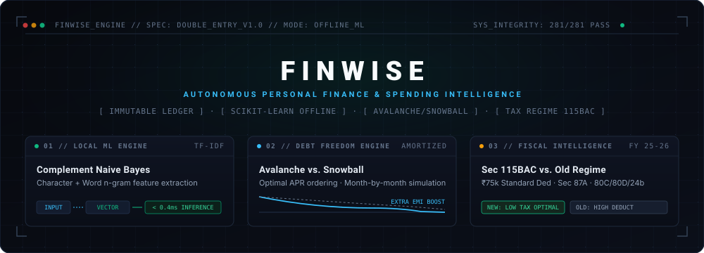
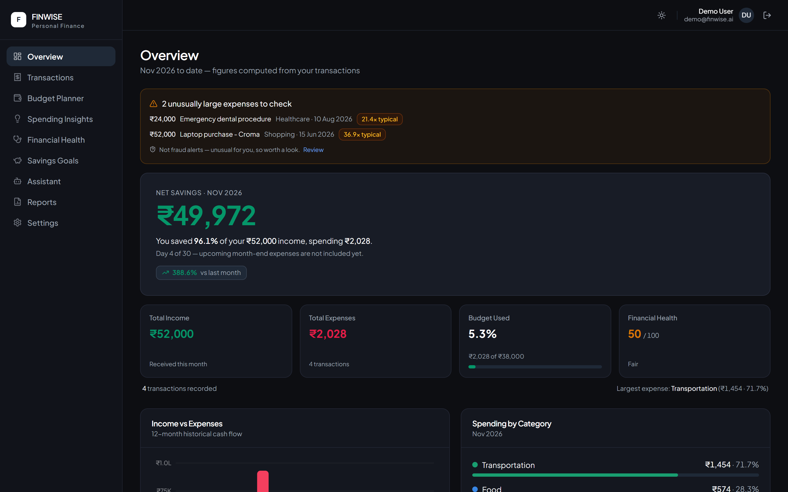
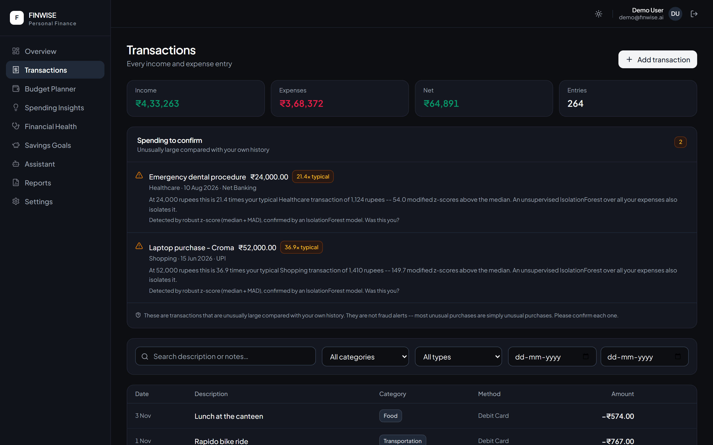
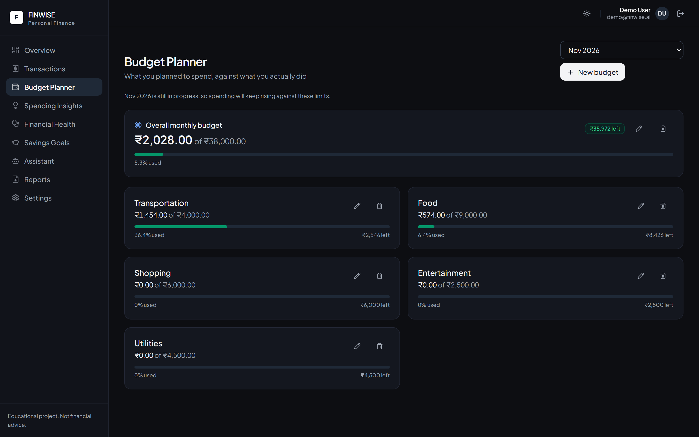
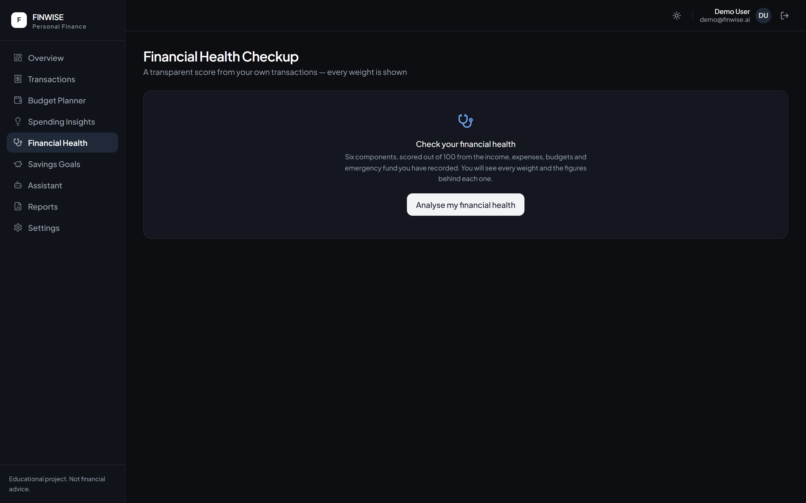
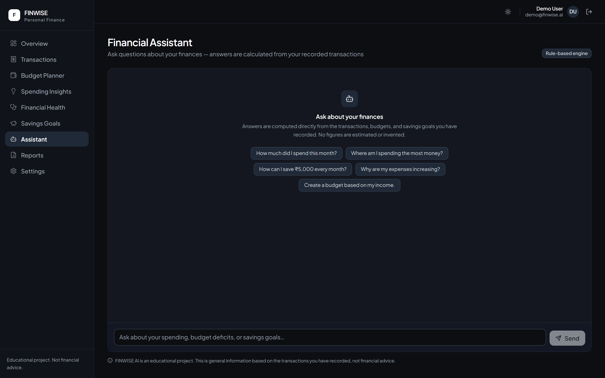
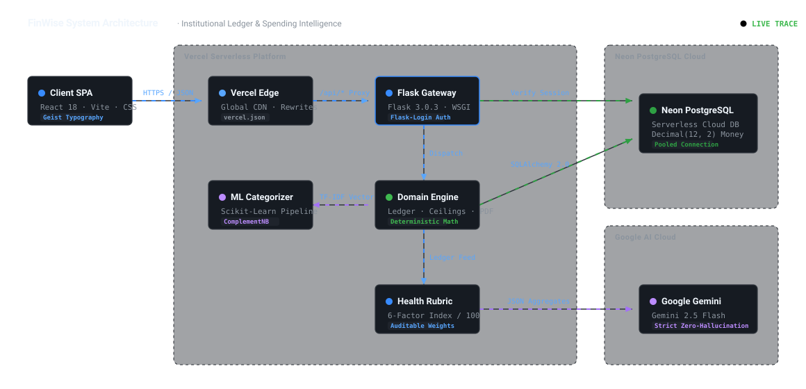

<p align="center">
  
</p>

<p align="center">
  
  &nbsp;
  
  <br />
  
  &nbsp;
  
  &nbsp;
  <a href="https://finwise-omega-nine.vercel.app/"></a>
</p>

<p align="center">
  <strong>A zero-telemetry personal finance operating system engineered for absolute privacy and mathematical precision.</strong><br>
  Records every transaction into an immutable double-entry ledger while orchestrating sub-millisecond offline machine learning categorization, dual debt acceleration simulations, and real-time balance sheet intelligence.
</p>

<p align="center">
  <a href="https://finwise-omega-nine.vercel.app/"><strong>Explore Live Demo »</strong></a> &nbsp;•&nbsp; 
  <a href="https://finwise-omega-nine.vercel.app/architecture.html"><strong>Interactive System Graph »</strong></a> &nbsp;•&nbsp; 
  <a href="#key-capabilities"><strong>Core Engines »</strong></a> &nbsp;•&nbsp; 
  <a href="#getting-started"><strong>Quick Start »</strong></a>
</p>

---

<p align="center">
  
</p>

---

## Visual Showcase

<div align="center">
  <table>
    <tr>
      <td width="50%">
        
        <p align="center"><strong>Transaction Ledger & CSV Importer</strong><br>Offline ML categorization, instant filter toolbar, batch statement upload.</p>
      </td>
      <td width="50%">
        
        <p align="center"><strong>Budget Ceilings</strong><br>Category utilization limits, 80% pacing warnings, and variance alerts.</p>
      </td>
    </tr>
    <tr>
      <td width="50%">
        
        <p align="center"><strong>Health Rubric & Runway Simulator</strong><br>100-point transparent scoring and emergency safety modeling.</p>
      </td>
      <td width="50%">
        
        <p align="center"><strong>Query Ledger Assistant</strong><br>Deterministic math calculation with optional Gemini 3.5 Flash phrasing.</p>
      </td>
    </tr>
  </table>
</div>

---

## Key Capabilities

### 1. Wealth & Balance Sheet Intelligence
- **Net Worth & Asset Tracker**: Real-time asset-to-liability portfolio tracking across liquid savings, equity holdings, deposits, gold, and properties.
- **Debt Payoff Engine (Avalanche vs. Snowball)**: Amortized interest simulation comparing Mathematical Avalanche (highest APR first) against Behavioral Snowball (smallest balance first) with extra payment acceleration sliders.
- **Emergency Runway & Safety Simulator**: Survival runway modeling in months based on liquid reserves vs non-negotiable living expenses, featuring 4 interactive stress test scenarios (Job loss, 25% salary cut, emergency medical shock, inflation spike).
- **Tax Regime Estimator (Old vs. New)**: Instant calculation under Indian Income Tax (Section 115BAC with ₹75k standard deduction and 87A rebate) vs Old Regime (with 80C, 80D, and 24b deductions), delivering net take-home comparisons.

### 2. Core Accounting & Ledger
- **Cash Flow Analytics**: Double-entry style bookkeeping of inflows and outflows with monthly net retention rates.
- **Bank Statement CSV Importer**: Automated CSV statement ingestion with client-side preview, duplicate protection, and automated categorization.
- **Offline ML Categorization**: Local Scikit-Learn model (TF-IDF character/word n-grams + Complement Naive Bayes) running sub-millisecond merchant classification offline without external API latency. User corrections retrain the model dynamically.
- **Subscriptions & Recurring Bill Tracker**: Automated recurring charge detection from transaction histories, 7-day renewal countdowns, and one-click payment logging.
- **Category Budget Limits**: Dynamic monthly spending ceilings with 80% and 100% threshold utilization tracking.
- **Automated Statement Exports**: Download comprehensive PDF statements with audit breakdowns via ReportLab or export ledger CSV files.

### 3. Natural Language Ledger Query
- Natural-language question answering backed by deterministic SQL and pandas analytics.
- Dual-mode architecture: Runs 100% offline via a built-in rule engine, or seamlessly connects to **Google Gemini 3.5 Flash** for conversational polish when an API key is provided.

---

## Architecture & System Design

<div align="center">
  <a href="https://finwise-omega-nine.vercel.app/architecture.html">
    
  </a>
  <p><em>Click the diagram above to launch the interactive SVG architecture explorer.</em></p>
</div>

The application deploys as a cohesive, serverless system on Vercel:
- **Client Tier**: React 18 single-page application built with Vite and Tailwind CSS. Employs code-splitting with `React.lazy` to maintain an initial load bundle under 190 kB.
- **API Tier**: Flask 3.0 WSGI microservice running serverless on Vercel (`api/index.py`), providing authenticated REST endpoints.
- **Persistence Tier**: Cloud PostgreSQL on Neon with connection pooling, and automatic local SQLite fallback for disconnected development.
- **Machine Learning Engine**: Scikit-Learn model serialized with Joblib, running embedded inside the Python backend process with zero cloud API dependencies.

---

## Tech Stack

| Layer | Technologies |
|---|---|
| **Frontend UI** | React 18, Vite 8, Tailwind CSS, Recharts, Lucide Icons |
| **Backend API** | Python 3.12, Flask 3.0, Flask-Login, Flask-CORS, SQLAlchemy 2.0 |
| **Database** | PostgreSQL (Neon Serverless) / SQLite (Local), Alembic |
| **Machine Learning** | Scikit-Learn (`TfidfVectorizer` + `ComplementNB`), NumPy, Joblib |
| **Document Engine** | ReportLab (PDF Statements), Native CSV Engine |
| **Optional LLM** | Google Gemini 3.5 Flash (`google-genai` SDK) |
| **Infrastructure** | Vercel (Single-Repo SPA + Serverless WSGI), GitHub Actions |

---

## Getting Started

### Prerequisites
- **Python**: 3.11 or 3.12
- **Node.js**: 20 or higher
- **Git**

### 1. Clone & Setup Backend
```bash
git clone https://github.com/Git-huber2007/FinWise.git
cd FinWise/finwise/backend

# Create virtual environment
python -m venv .venv

# Activate environment
# On Windows (PowerShell):
.\.venv\Scripts\Activate.ps1
# On macOS/Linux:
source .venv/bin/activate

# Install dependencies
pip install -r requirements.txt

# Seed local database (generates 8 months of realistic test transactions)
python seed.py --reset

# Start development API server (http://localhost:5000)
python app.py
```

### 2. Setup Frontend
In a new terminal window:
```bash
cd FinWise/finwise/frontend

# Install dependencies
npm install

# Start Vite dev server (http://localhost:5173)
npm run dev
```

Visit `http://localhost:5173` to explore the application. Default seed login:
- **Email**: `alex@example.com`
- **Password**: `password123`

---

## Testing & Quality Assurance

FinWise includes a comprehensive test suite covering authentication, ledger calculations, ML classification, tax estimation, and debt simulation:

```bash
cd finwise/backend
python -m pytest tests/
```

```text
============================= test session starts =============================
platform win32 -- Python 3.12.10, pytest-8.3.3
rootdir: FinWise/finwise/backend
collected 281 items

tests/test_analytics_and_health.py ..................................... [ 13%]
tests/test_auth_and_transactions.py ..................................    [ 22%]
tests/test_budgets.py .................................                  [ 33%]
tests/test_categorizer.py ...............................                 [ 44%]
tests/test_chat.py ..................................................... [ 65%]
tests/test_debt.py ..                                                    [ 66%]
tests/test_importer.py ..                                                [ 67%]
tests/test_models.py ..................                                  [ 73%]
tests/test_net_worth.py ...                                              [ 74%]
tests/test_reports.py ...................................                [ 87%]
tests/test_runway.py ..                                                  [ 87%]
tests/test_savings_and_anomaly.py ............................           [ 97%]
tests/test_subscriptions.py .....                                        [ 98%]
tests/test_tax.py ...                                                    [100%]

============================ 281 passed in 57.39s =============================
```

---

## API Reference

| Endpoint | Method | Description |
|---|---|---|
| `/api/auth/login` | `POST` | Authenticate and issue secure session cookie |
| `/api/transactions` | `GET`, `POST` | Query filtered transactions or record new ledger entry |
| `/api/transactions/<id>` | `PUT`, `DELETE` | Update or remove existing ledger record |
| `/api/import/preview` | `POST` | Parse statement CSV and return ML auto-categorization |
| `/api/import/commit` | `POST` | Batch insert confirmed statement rows into ledger |
| `/api/subscriptions` | `GET`, `POST` | List recurring bills or create new subscription |
| `/api/subscriptions/<id>/mark-paid` | `POST` | Log recurring charge payment and advance billing cycle |
| `/api/net-worth` | `GET` | Calculate net worth, liquid reserves, and asset allocation |
| `/api/net-worth/assets` | `POST` | Record an asset (bank, investment, gold, property) |
| `/api/debt` | `GET`, `POST` | Query debt payoff strategies (Avalanche vs Snowball) or add debt |
| `/api/tax/estimate` | `GET` | Compare Indian Income Tax (Old vs New Regime) |
| `/api/ai/runway` | `GET`, `POST` | Emergency safety runway simulation & stress test scenarios |
| `/api/ai/chat` | `POST` | Natural language ledger query interface |
| `/api/reports/pdf` | `GET` | Generate and stream formal monthly PDF statement |

---

## Environment Configuration

| Variable | Default | Purpose |
|---|---|---|
| `DATABASE_URL` | `sqlite:///finwise.db` | PostgreSQL connection string (Neon Cloud) |
| `SECRET_KEY` | Development key | Cryptographic session signing key |
| `SESSION_COOKIE_SECURE` | `0` | Enforce HTTPS-only session cookies in production |
| `GEMINI_API_KEY` | None (Rule-engine fallback) | Google AI Studio API key for Gemini 3.5 Flash |
| `GEMINI_MODEL` | `gemini-3.5-flash-lite` | Gemini model variant |
