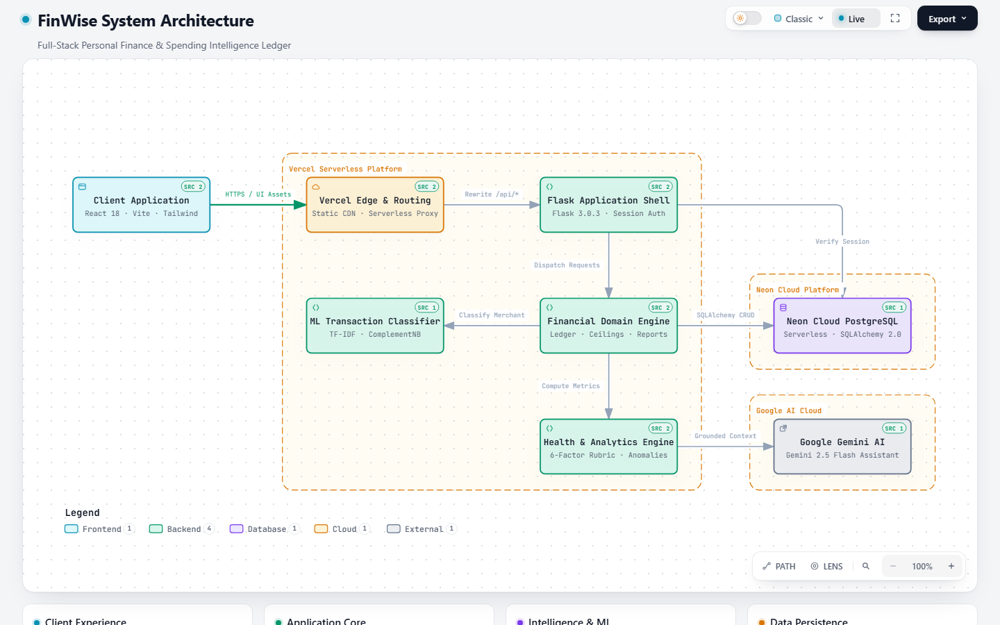
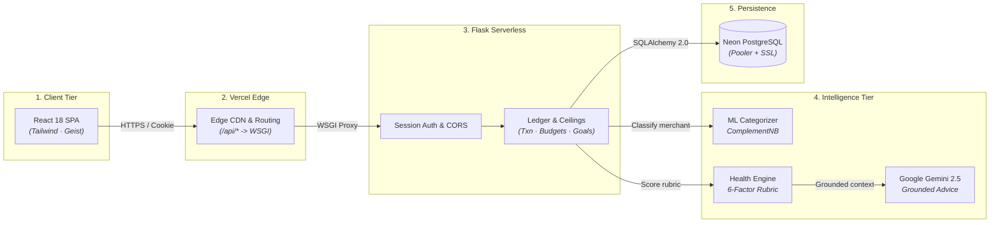

# FinWise — Personal Finance & Spending Intelligence

[](https://python.org)
[](https://react.dev)
[](https://vitejs.dev)
[](https://tailwindcss.com)
[](https://neon.tech)
[](https://vercel.com)
[](finwise/backend/tests)

FinWise is an institutional-grade personal finance and spending intelligence system. Designed with a calm, high-contrast fintech aesthetic (inspired by Stripe and Mercury), it completely rejects gratuitous "AI slop" — no floating neon blobs, purple sparkles, or fake confidence scores.

Every number, budget utilization metric, anomaly warning, and savings projection is deterministically computed from real transactions recorded in **Neon PostgreSQL** or local SQLite.

---

## Architecture Overview

<p align="center">
  <a href="https://finwise-omega-nine.vercel.app/architecture.html" title="Click to open live interactive explorer with live trace animation">
    <picture>
      <source media="(prefers-color-scheme: dark)" srcset="docs/architecture-dark.png">
      
    </picture>
  </a>
</p>

<p align="center">
  <em>Click the architecture diagram above to open the <strong>Live Interactive Explorer</strong> (with animated trace motion, pan/zoom, and node inspectors), or explore via the interactive component map below:</em>
</p>



---

## Core Capabilities

### 1. High-Density Dashboard & Cash Flow
- Real-time **Net Savings Rate**, total monthly income, expenses, and savings breakdown.
- Cash flow comparison charts with historical 8-month trajectory.
- Category distribution breakdown with clean bar and area visualizations.

### 2. Transaction Management & Automated Categorization
- High-volume transaction ledger with live filtering by category, payment method, date range, and amount.
- **Offline ML Categorizer**: Powered by a trained `scikit-learn` Multinomial Naive Bayes model (`categorizer.joblib`) that predicts transaction categories in real-time as you type, without calling external APIs.
- User overrides are tracked and fed back into model retraining.

### 3. Budget Intelligence & Utilization Tracking
- Flexible monthly budget limits per category (Housing, Food, Utilities, Entertainment, Healthcare, Investments).
- Real-time utilization bars with amber and crimson thresholds at 80% and 100%.
- Unbudgeted expense isolation to highlight unmonitored leaks.

### 4. Anomaly Detection
- Unsupervised statistical detection flags purchases that deviate sharply from your personal historical mean.
- Transparent indicators showing standard deviation multiples rather than opaque "risk scores".

### 5. Goal Progression & Realistic Forecasting
- Visual target tracking for short-term and long-term milestones.
- **Honest Trend Forecasting**: The algorithm evaluates linear trend fit ($R^2$); if monthly savings variance is too volatile, it explicitly refuses to project a misleading completion date and explains why.

### 6. Dynamic Financial Statements & Reports
- Generate server-side monthly PDF financial statements formatted with `ReportLab`.
- Export filtered transaction ledgers as standard CSV files for audit or tax preparation.

### 7. Dual-Engine Financial Assistant
- **Offline Mode (Default)**: Fully functional rule-based financial conversational agent that answers spending queries, checks category headroom, and analyzes monthly trends.
- **LLM Mode (Optional)**: Set `GEMINI_API_KEY` to upgrade the assistant to **Gemini 2.5 Flash**, giving contextual advice grounded in your recorded spending data.

---

## Tech Stack

| Layer | Technology | Purpose |
|---|---|---|
| **Frontend** | React 19, Vite, Tailwind CSS, Lucide Icons | Responsive SPA, institutional dark/light design system |
| **Backend** | Python 3.12, Flask, Flask-Login, Flask-CORS | REST API with session authentication and route protection |
| **ORM & Database** | SQLAlchemy 2.0, Neon PostgreSQL, SQLite | Cloud serverless database with local fallback |
| **Machine Learning**| Scikit-Learn, NumPy, Joblib | Offline merchant classification and anomaly detection |
| **Document Engine**| ReportLab | High-resolution PDF generation with Indian Rupee (`₹`) support |
| **Deployment** | Vercel (Frontend & Serverless API), Neon (Cloud DB) | Single-click global edge deployment |

---

## Local Setup & Quickstart

### Prerequisites
- **Python 3.11+** (3.12 recommended)
- **Node.js 20+** (22+ recommended)

### 1. Clone & Set Up Backend

```bash
# Clone the repository
git clone https://github.com/Git-huber2007/FinWise.git
cd FinWise/finwise/backend

# Create virtual environment
python -m venv .venv

# Activate virtual environment
# Windows:
.\.venv\Scripts\activate
# macOS/Linux:
# source .venv/bin/activate

# Install dependencies
pip install -r requirements.txt

# Seed the database (creates tables & 8 months of realistic demo data)
python seed.py --reset

# Start the Flask API server
python app.py
```
Backend API will start on **http://localhost:5000**.

### 2. Set Up Frontend

In a new terminal:

```bash
cd FinWise/finwise/frontend

# Install dependencies
npm install

# Start Vite dev server
npm run dev
```

Open **http://localhost:5173** in your browser.

### Demo Credentials
- **Email**: `demo@finwise.ai`
- **Password**: `demo1234`

*(You can also register a new account to test zero-data states).*

---

## Verification & Testing

Every single endpoint, calculation, and component is tested against strict test suites:

```bash
# Run backend test suite (264 unit & integration tests)
cd finwise/backend
pytest -q

# Run frontend production build
cd finwise/frontend
npm run build
```

---

## Deploying to Vercel (100% All-in-One)

The project includes root [`vercel.json`](vercel.json) and [`api/index.py`](api/index.py) configuration so that **both the React frontend and Flask API run on Vercel**:

1. Go to [vercel.com](https://vercel.com) and click **"Add New..."** &rarr; **"Project"**.
2. Select your repository: **`Git-huber2007/FinWise`** and click **Import**.
3. Under **Project Settings**:
   - **Framework Preset**: Leave as default (`Other` or `Vite`).
   - **Root Directory**: Leave as `./` (repository root).
4. Expand **Environment Variables** and add:
   - `DATABASE_URL`: Your Neon PostgreSQL connection string:
     ```text
     postgresql://neondb_owner:<YOUR_PASSWORD>@ep-xyz-pooler.<region>.aws.neon.tech/neondb?sslmode=require
     ```
   - `SECRET_KEY`: A random 32-byte hex string (e.g. `b9848c7fa5aa0100a9e59385c601464c1063e53981e6f47077cd7c05ead4ec09`)
   - `GEMINI_API_KEY`: *(Optional)* Your Gemini API key from [Google AI Studio](https://aistudio.google.com).
   - `SESSION_COOKIE_SECURE`: `1` — required. Vercel serves over HTTPS, and
     without this the session cookie is issued without the `Secure` flag.
5. Click **Deploy**.

Vercel will automatically build the React bundle, deploy the Flask API as a serverless function, and route `/api/*` requests with zero CORS latency.

---

## Project Structure

```text
FinWise/
├── api/                        # Vercel Serverless Function entrypoint
│   ├── index.py                # WSGI application loader
│   └── requirements.txt        # Serverless Python dependencies
├── finwise/
│   ├── backend/                # Flask REST API
│   │   ├── ai/                 # ML categorizer, anomaly detector, health rubric
│   │   ├── routes/             # Auth, transactions, dashboard, budgets, goals, AI
│   │   ├── data/               # Merchant training dataset (563 labelled rows)
│   │   ├── tests/              # 264 unit and integration tests
│   │   ├── app.py              # Application factory & blueprint registration
│   │   ├── config.py           # Environment configuration & Neon Postgres parser
│   │   ├── models.py           # SQLAlchemy 2.0 typed data models
│   │   ├── seed.py             # Deterministic 8-month financial data seeder
│   │   └── wsgi.py             # WSGI entrypoint for production servers
│   └── frontend/               # Vite React Single Page Application
│       ├── src/
│       │   ├── components/     # High-contrast UI components, charts, navigation
│       │   ├── pages/          # Dashboard, Transactions, Budgets, Goals, Reports
│       │   ├── api.js          # Centralized fetch client with credential support
│       │   ├── auth.jsx        # Authentication context & route guards
│       │   ├── format.js       # Indian digit grouping & currency formatters
│       │   └── index.css       # Tailwind utility tokens & slate color palette
│       ├── index.html          # Clean typography & head metadata
│       └── tailwind.config.js  # Institutional slate palette & geometry tokens
├── package.json                # Root build orchestrator
├── vercel.json                 # Vercel routing & serverless build specification
└── README.md                   # Project documentation
```

---

## Security & Privacy Standards

- **Zero Client-Side Secrets**: Database credentials and optional LLM keys are read exclusively server-side.
- **Session Protection**: Cookies use `HttpOnly`, `SameSite=Lax`, and optional `Secure` flags.
- **Password Hashing**: Stored with Werkzeug's `generate_password_hash` using PBKDF2-SHA256 with dynamic salt.
- **Sanitized Exports**: Sensitive account data is excluded from CSV and PDF statement dumps.

---

## Disclaimer

FinWise is an educational personal finance tracking tool. It does not provide certified financial, tax, or legal advice. Anomaly detections and financial health scores are calculated strictly from user-recorded data as self-reflection aids, not credit ratings.

---

## License

Distributed under the MIT License. See `LICENSE` for details.

